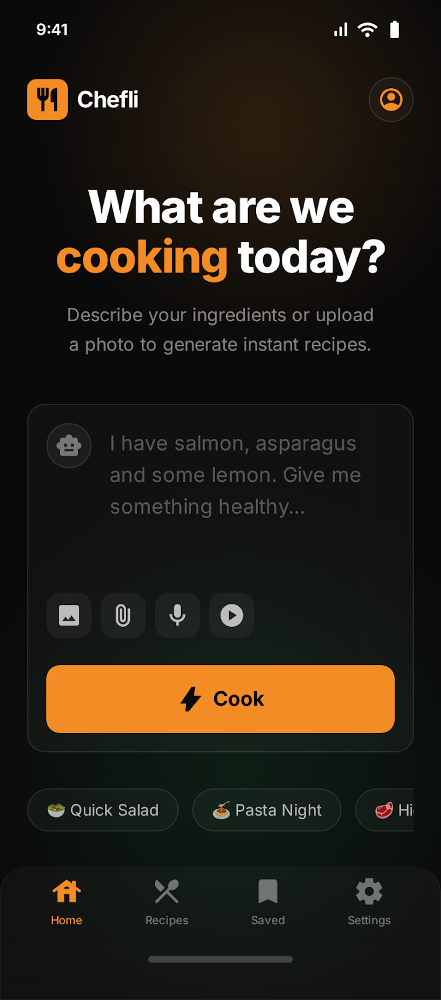
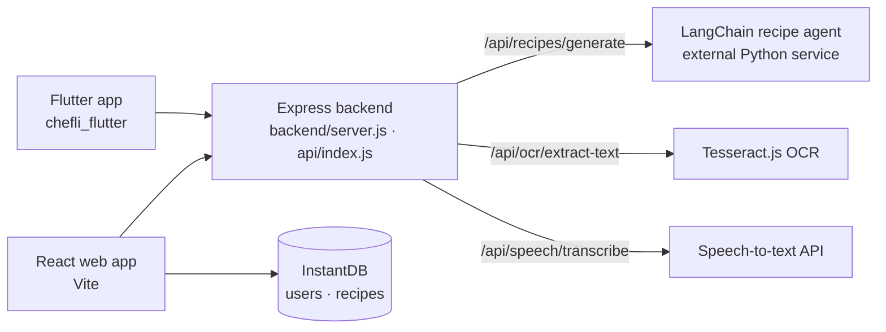

# Chefli

**Tell Chefli what's in your fridge (typed, photographed or spoken) and it turns it into a full recipe, on the web and in a Flutter mobile app.**

**Live:** https://chefli.vercel.app



## What it does

- **Ingredients in, recipe out.** Enter the ingredients you have and get a generated recipe with steps and timing.
- **Three ways to input:** type a list, **upload a photo** of a list or label (OCR), or **record your voice** (speech-to-text).
- **Saved recipes and history** per user, plus a profile and settings.
- **Google Sign-In.**
- **English and Hebrew**, dark and light themes.
- **Mobile app** (`chefli_flutter/`) with the same flow, plus a step-by-step cooking screen with text-to-speech.

## Architecture



Backend endpoints: `GET /health`, `POST /api/recipes/generate`, `POST /api/ocr/extract-text`, `POST /api/speech/transcribe`, plus user endpoints (`/api/users/create`, `/api/users/find`, `/api/users/create-google`).

Key design decisions:

- **Backend as a thin proxy.** Clients never call the AI service directly: the Express backend forwards recipe requests to a separate LangChain agent (URL from `LANGCHAIN_URL`), which avoids CORS and keeps service keys server-side. It accepts both a comma-separated `menu` and an `ingredients` array.
- **One backend, three hosts.** The same Express app runs locally, in Docker (`Dockerfile`, `docker-compose.yml`), and as a serverless function on Vercel (`api/index.js` + `vercel.json` rewrites) or Netlify (`netlify.toml`).
- **Media handled server-side.** Uploads go through `multer`; OCR runs with Tesseract.js, and audio goes to a hosted transcription API.
- **InstantDB for data and permissions.** User and recipe data live in InstantDB, with access rules in `rules.js` (users read their own data).
- **Two clients, one API.** The React web app and the Flutter app share the backend, so features land in both.

## Tech stack

- **Web:** React 19, Vite, React Router, Framer Motion, lucide-react, axios
- **Mobile:** Flutter (Dart), Provider, go_router, Firebase Auth + Google Sign-In, speech_to_text, flutter_tts, image_picker, record
- **Backend:** Node.js, Express, multer, cors
- **Data:** InstantDB (`@instantdb/react`, `@instantdb/admin`)
- **AI / media:** LangChain recipe agent (Python service), Tesseract.js OCR, hosted speech-to-text
- **Testing:** Playwright end-to-end tests (`tests/`: API endpoints, auth, web app)
- **Deploy:** Vercel, Netlify or Docker

## Project structure

```
src/              React web app (pages, components, services, context)
backend/          Express server (recipe proxy, OCR, transcription)
api/              Serverless entry for Vercel
chefli_flutter/   Flutter mobile app (+ designs/)
tests/            Playwright e2e tests
```

## Run locally

Prerequisites: Node.js 20+ (and Flutter for the mobile app).

```bash
npm install
cp .env.example .env.development   # fill in your own values; see ENV_SETUP.md
npm run dev:all                    # backend on :3000 + web app on :5173
```

Other scripts: `npm run dev` (web only), `npm run backend` (API only), `npm run build`, `npm run test:e2e`.

Environment variable names (values are never committed): `INSTANTDB_APP_ID`, `INSTANTDB_ADMIN_TOKEN`, `BACKEND_URL` / `VITE_BACKEND_URL`, `GOOGLE_CLIENT_ID`, `GOOGLE_CLIENT_SECRET`, `GOOGLE_REDIRECT_URI`, and optionally `LANGCHAIN_URL`. See `ENV_SETUP.md` and `GOOGLE_OAUTH_SETUP.md`.

Mobile app:

```bash
cd chefli_flutter
flutter pub get
flutter run
```

## Status

Working product: the web app is live on Vercel and the Flutter app uses the production backend. Setup and deployment notes are in the `*.md` guides at the repo root.

## Author

**Or Delevski** · https://ordelwebsite.vercel.app
